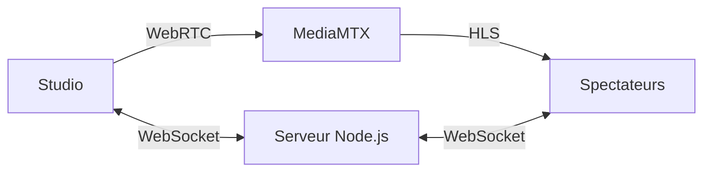

# REGAM Live

Studio de diffusion en direct en darija. L’animateur peut partager sa caméra et son écran, inviter un spectateur sur scène et modérer le chat.

| Espace | Adresse | Fonction |
| --- | --- | --- |
| Spectateurs | `/` | Regarder le direct, commenter et demander à monter sur scène |
| Studio | `/studio` | Ouvrir une session, préparer le direct et modérer les commentaires |
| État du serveur | `/healthz` | Vérifier que le serveur répond et connaître l’état du direct |

## Essayer le chat sur Mac

Prérequis recommandé pour cette procédure : Node.js 22.

1. Dans Terminal, place-toi dans le dossier du projet.
2. Installe les dépendances et prépare la configuration locale.

   ```bash
   npm ci
   cp .env.example .env
   ```

3. Dans `.env`, renseigne `ADMIN_PASSWORD` avec un mot de passe local d’au moins huit caractères. Garde ce fichier sur ton appareil.
4. Démarre le serveur.

   ```bash
   node --env-file=.env server.js
   ```

5. Ouvre [la page spectateurs](http://127.0.0.1:3000/) et [le studio](http://127.0.0.1:3000/studio) dans Chrome. Connecte-toi au studio, puis envoie un commentaire depuis la page spectateurs. Le statut du direct reste hors ligne pendant cet essai du chat.

## Architecture



MediaMTX et FFmpeg assurent la diffusion vidéo et audio. Le serveur Node.js gère le chat, la modération et les invitations sur scène. Les commentaires récents sont conservés en mémoire, dans la limite de 150, puis perdus au redémarrage du serveur. Le studio est prévu pour Chrome ou Edge sur ordinateur.

## Installer la diffusion sur un VPS

Sur un VPS Ubuntu ou Debian, configure un domaine qui pointe vers le serveur. Depuis le dossier du projet, lance ensuite l’installateur avec ton domaine et ton adresse e-mail.

```bash
sudo bash install.sh live.example.com admin@example.com
```

L’installateur prépare Docker Compose, MediaMTX et le proxy. Les ports à ouvrir sur le VPS sont `80/tcp`, `443/tcp`, `8189/udp` et `8189/tcp`. Après installation, utilise le domaine en HTTPS et vérifie le direct depuis un deuxième appareil. Pour une audience importante, la diffusion HLS peut passer par un CDN configuré avec `HLS_PUBLIC_URL`.

## Lancer les tests

```bash
npm ci
npm run test:chat
```

Le test de chat démarre le vrai serveur sur un port local temporaire. Il vérifie l’envoi des commentaires, la réponse du studio, l’historique récent, la limitation de fréquence et la modération.

Pour les tests navigateur, installe FFmpeg sur la machine, puis lance :

```bash
npx playwright install chromium
npm test
```

Cette suite utilise un relais de test pour les médias. La configuration MediaMTX du VPS se vérifie sur le déploiement.
